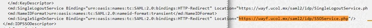
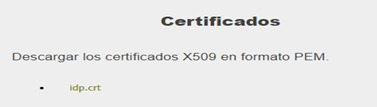
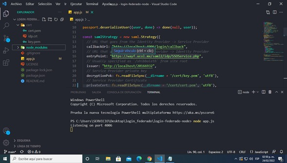
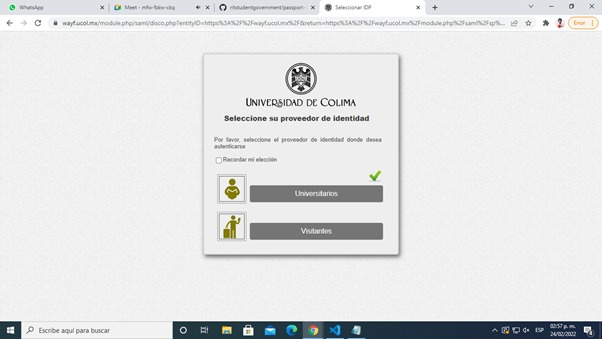
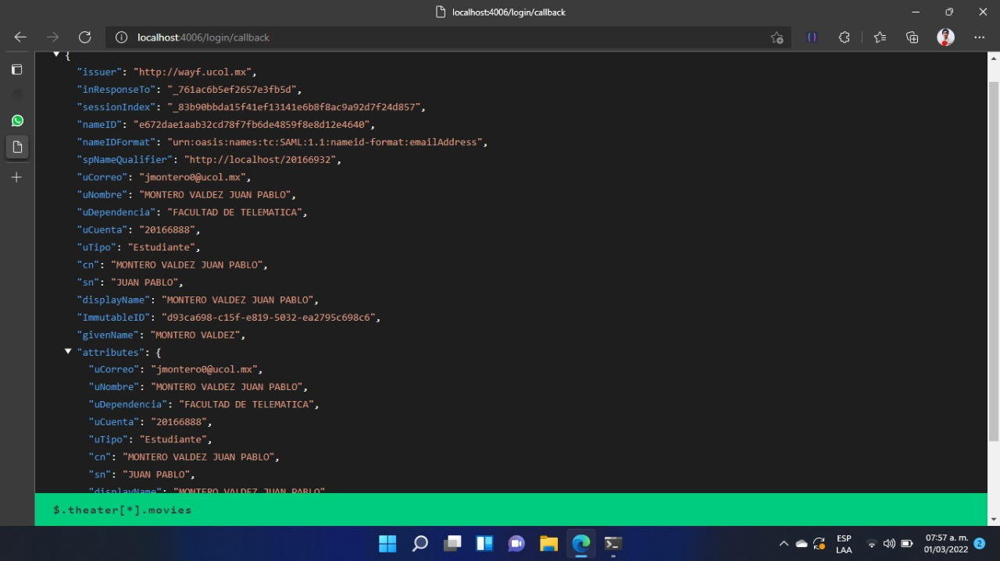

# Demo de login federado con Node.js

Demo de integración con la Federación de Identidades de la Universidad de Colima usando Node.js, Express y [passport-saml](https://github.com/node-saml/passport-saml). La aplicación actúa como **Proveedor de Servicios (SP)** y se autentica contra el **Proveedor de Identidad (IdP)** de UCOL mediante SAML 2.0.

> **Importante:** este demo solo funciona con la configuración incluida (puerto, `issuer` y certificados). Si cambia alguno de estos valores, el IdP rechazará la autenticación. **No cambie el puerto de escucha ni los certificados** mientras esté en desarrollo.

## Contenido

- [Requisitos](#requisitos)
- [Inicio rápido](#inicio-rápido)
- [Rutas](#rutas)
- [Configuración de SAML](#configuración-de-saml)
- [Certificados](#certificados)
- [Flujo de autenticación](#flujo-de-autenticación)
- [Paso a producción](#paso-a-producción)
- [Más información](#más-información)

## Requisitos

- [Node.js](https://nodejs.org/) (versión LTS)
- npm
- OpenSSL (solo si necesita generar certificados propios)

## Inicio rápido

```powershell
git clone https://github.com/Universidad-de-Colima/login-federado-node.git
cd login-federado-node
npm install
node app.js
```

El servidor queda escuchando en `http://localhost:4006`. Al abrir esa dirección, la aplicación lo redirige a `/login` y de ahí al inicio de sesión del IdP.

### Dependencias

| Paquete | Uso |
| --- | --- |
| `@node-saml/passport-saml` | Estrategia SAML para Passport |
| `passport` | Middleware de autenticación |
| `express` | Servidor web |
| `express-session` | Manejo de sesiones |
| `cors` | Habilita CORS |
| `dotenv` | Carga de variables de entorno |

## Rutas

| Método | Ruta | Descripción |
| --- | --- | --- |
| GET | `/` | Redirige a `/login` |
| GET | `/login` | Inicia el SSO: redirige al IdP si no hay sesión |
| POST | `/api/auth/login/callback` | Recibe la respuesta SAML del IdP y devuelve el perfil del usuario |
| GET | `/api/auth/logout` | Inicia el cierre de sesión en la aplicación y en el IdP |
| POST | `/api/auth/logout/callback` | Cierra la sesión local cuando el IdP responde |
| GET | `/login/fail` | Responde `401` cuando falla la autenticación |
| GET | `/Metadata` | Metadatos XML del SP (se entregan a sistemas) |

## Configuración de SAML

La estrategia se define en [app.js](app.js):

```javascript
const samlStrategy = new saml.Strategy({
  callbackUrl: "http://localhost:4006/login/callback",
  entryPoint: "https://wayf.ucol.mx/saml2/idp/SSOService.php",
  logoutUrl: 'https://wayf.ucol.mx/saml2/idp/SingleLogoutService.php',
  logoutCallbackUrl: 'http://localhost:4006/logout/callback',
  issuer: "http://localhost/20166932",
  decryptionPvk: fs.readFileSync(__dirname + '/cert/key.pem', 'utf8'),
  idpCert: fs.readFileSync(__dirname + '/cert/idp.crt', 'utf8'),
  acceptedClockSkewMs: -1
}, (profile, done) => done(null, profile));
```

| Parámetro | Descripción |
| --- | --- |
| `callbackUrl` | URL absoluta de su aplicación que recibe la respuesta SAML una vez que el IdP autentica al usuario |
| `entryPoint` | URL del IdP a la que se redirige al usuario para iniciar sesión (`SingleSignOnService`) |
| `logoutUrl` | URL del IdP para el cierre de sesión (`SingleLogoutService`) |
| `logoutCallbackUrl` | URL de su aplicación que recibe la respuesta del IdP al cerrar sesión |
| `issuer` | Identificador único del SP ante el IdP (`entityID`) |
| `decryptionPvk` | Llave privada para descifrar las aserciones cifradas que envía el IdP |
| `idpCert` | Certificado público del IdP, necesario para validar la firma de sus respuestas |
| `acceptedClockSkewMs` | Desfase de reloj tolerado. `-1` desactiva la validación de tiempos (ver nota abajo) |

> **Nota sobre `acceptedClockSkewMs: -1`:** el demo desactiva la validación de las marcas de tiempo por un desfase en el reloj del IdP. No use este valor en producción.

### Obtener `entryPoint` e `idpCert`

Ambos datos están en los metadatos del IdP:

<https://wayf.ucol.mx/saml2/idp/metadata.php?output=xhtml>

`entryPoint` se toma del `SingleSignOnService`:



El certificado del IdP se guarda como `cert/idp.crt`:



## Certificados

La carpeta `cert/` contiene:

| Archivo | Contenido |
| --- | --- |
| `key.pem` | Llave privada del SP (usada en `decryptionPvk`) |
| `cert.pem` | Certificado público del SP (se publica en `/Metadata`) |
| `idp.crt` | Certificado público del IdP |

Los incluidos en este repositorio son **solo para desarrollo**. Para generar un par propio:

```powershell
openssl req -x509 -newkey rsa:4096 -keyout key.pem -out cert.pem -nodes -days 900
```

## Flujo de autenticación

1. El usuario abre `/` y la aplicación lo redirige a `/login`.
2. Passport genera la solicitud SAML y redirige al IdP (`entryPoint`).
3. El usuario captura sus credenciales en el IdP.
4. El IdP envía por POST la respuesta SAML (en base64) a la ruta de callback.
5. Passport valida la firma, descifra la aserción y deja el perfil en `req.user`.

### Datos del usuario

Al autenticarse, `req.user` contiene los atributos que entrega el IdP, por ejemplo:

`uCorreo`, `uNombre`, `uDependencia`, `uCuenta`, `uTrabajador`, `uTipo`, `cn`, `sn`, `displayName`, `givenName`.

```javascript
app.post('/api/auth/login/callback', passport.authenticate('saml', {
  failureRedirect: '/login/fail',
  failureFlash: true
}), (req, res) => {
  const { uCorreo, uNombre } = req.user;
  res.send(req.user);
});
```

### Cierre de sesión

`GET /api/auth/logout` genera la solicitud de cierre de sesión (`samlStrategy.logout`) y redirige al IdP. Cuando el IdP responde, `POST /api/auth/logout/callback` ejecuta `req.logout()` y regresa al inicio.

## Paso a producción

Para poner una aplicación en producción escriba a <sistemas@ucol.mx> para conocer el procedimiento. Deberá contar con:

- Un `entityID` (`issuer`) propio.
- Certificados propios. Los de este repositorio son solo para desarrollo.
- Su `callbackUrl` y `logoutCallbackUrl` en HTTPS.

Entregue a sistemas los metadatos de su aplicación, disponibles en la ruta `/Metadata`. Por ejemplo, en desarrollo: <http://localhost:4006/Metadata>

## Capturas de referencia







## Más información

- Federación de Identidades de la Universidad de Colima: <https://portal.ucol.mx/federacion-identidades/>
- Documentación de passport-saml: <https://github.com/node-saml/passport-saml>
